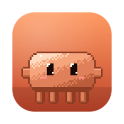
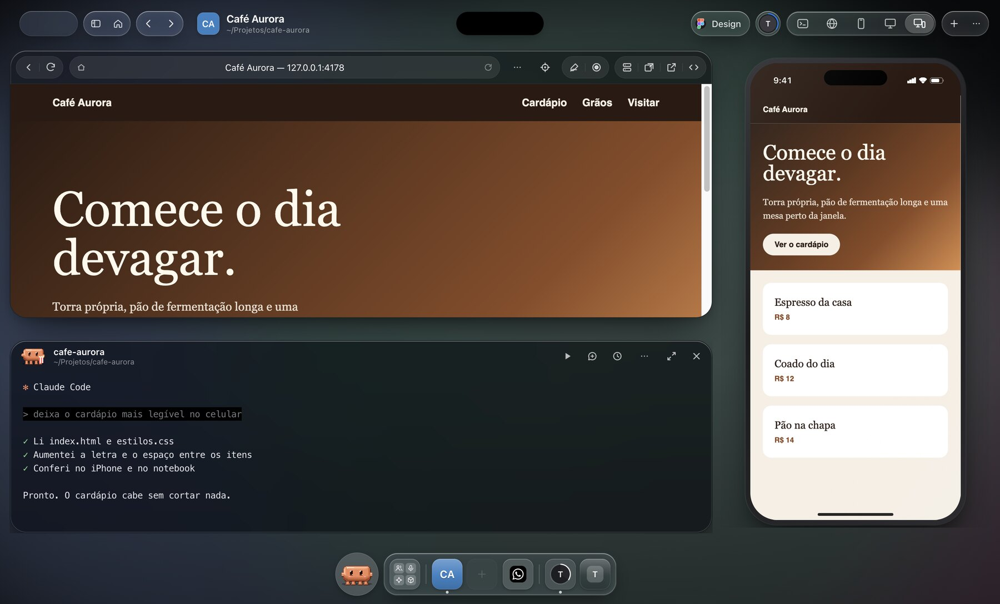
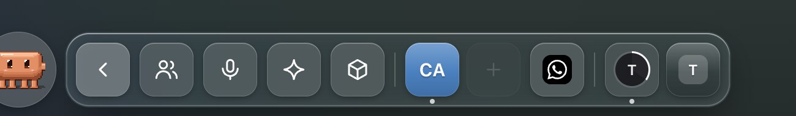
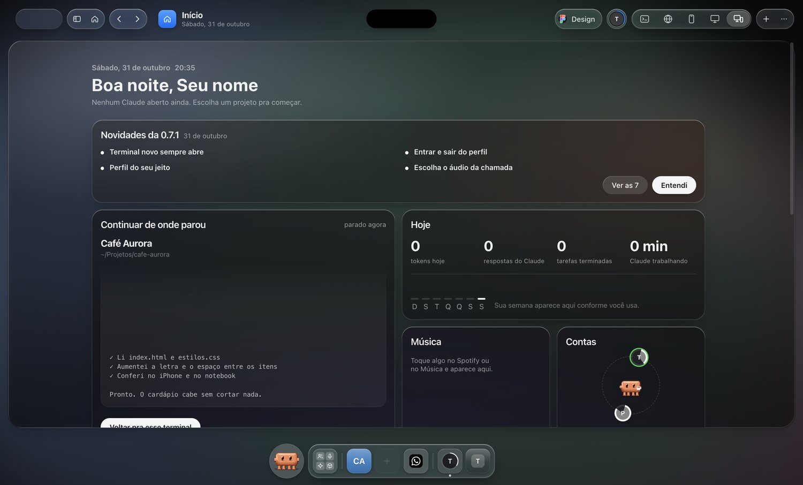
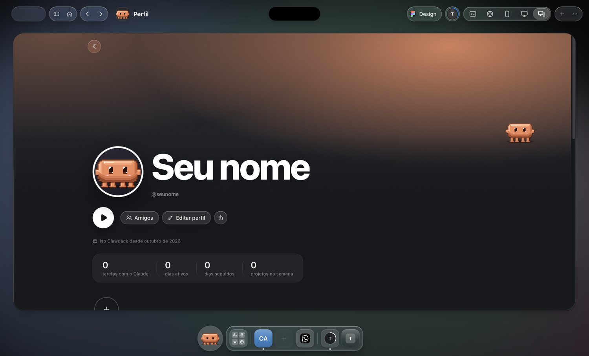
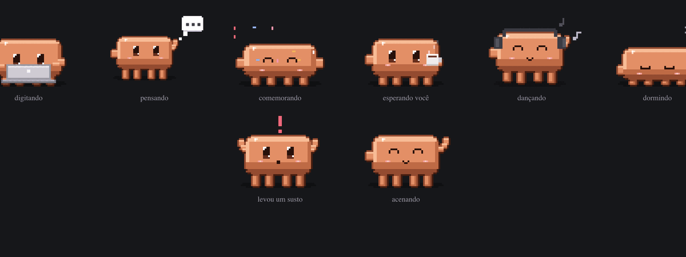

# Clawdeck

**O terminal para trabalhar com o Claude Code, com o site e o celular ao lado.**

Vários projetos, várias contas, o site aberto num celular de verdade e o Clawd fazendo companhia.

[**Baixar a última versão**](../../releases/latest)

 

## O que ele faz

Cada projeto tem seus terminais e seu site, tudo numa janela só. Quando uma conta do Claude chega no limite, o app passa para a próxima e a conversa continua. **Tudo funciona por botão**, sem atalho para decorar.

## Dock

Cada projeto é um ícone. Ferramentas, sites e contas ficam em pastinhas que abrem e recolhem, e você escolhe a ordem e o que aparece. Sua foto fica ao lado, separada, e abre o seu perfil.

## O site ao lado, num celular de verdade

- **Layouts prontos:** Estúdio, Foco no código, Meio a meio, Site grande e Celular grande.
- **Tela de celular:** tamanho, toque e navegador de iPhone, Galaxy e Pixel, e a barra de status acompanha a cor do site.
- **`localhost` automático:** quando um terminal sobe um servidor, o site abre sozinho.
- **Pedir apontando:** clique em algo do site, escreva o que quer e o pedido vai para o Claude com um print.

## Ilha

A ilha no topo mostra o que o Claude está fazendo e a música tocando. Quando ele termina ou pede permissão, ela avisa e você responde dali mesmo.

## Início

Continue de onde parou, veja os números do dia, suas contas e o que mudou em cada versão.

## Seu perfil

Uma página de artista: banner, foto e fundo com imagem ou GIF, cores de texto e cartões, e GIFs e fotos em qualquer lugar, fixos ou rolando com a página. Seus projetos viram Populares e Discografia.

Cada terminal tem o seu Clawd, com cor, estilo e acessórios próprios, que reage ao que o Claude está fazendo.

## Conversa por voz

Peça um trabalho falando e um Claude faz no terminal ao lado. Dá para interromper falando por cima, corrigir uma frase e escolher o fone e o microfone.

No Mac, ele ouve e fala. No Windows, por enquanto, ele fala e você escreve.

## Para o dia inteiro

- **Mudanças:** veja o diff, escolha os arquivos e faça commit sem sair do app.
- **Conversas guardadas:** um terminal fechado sem querer pode ser retomado.
- **Fila e pedidos salvos:** deixe o próximo pedido na fila e guarde as frases que você repete.
- **Conversa longa:** quando fica grande e parada, ele escreve um resumo e continua gastando menos.
- **Turno da noite:** deixe tarefas rodando enquanto você dorme.
- **Celular e tablet:** pareie por QR para aprovar pedidos e acompanhar de longe.
- **Trabalhar em dupla:** duas pessoas no mesmo terminal.
- **Gemini:** abre num terminal do projeto, com sua conta Google. O Claude só consulta o Gemini se você ligar.

## Design

No botão **Design**: Figma, editor de pixel art, paleta e fontes, referências, `DESIGN.md` e inspeção do site.

**AgentCraft** (opcional): uma equipe de Claudes no seu projeto, vista dentro de um estúdio do Minecraft.

## Instalar

Precisa do [Claude Code](https://docs.anthropic.com/claude-code) instalado. Baixe o arquivo do seu sistema na [última versão](../../releases/latest).

O app ainda não tem assinatura paga da Apple e da Microsoft, então na primeira vez aparece um aviso:

- **Mac (Apple Silicon):** abra o `.zip` e leve o Clawdeck para Aplicativos. Abra, feche o aviso e clique em **Abrir Mesmo Assim** em *Ajustes do Sistema › Privacidade e Segurança*.
- **Windows 10 e 11:** rode o `Setup`. Em *"O Windows protegeu o computador"*, clique em *Mais informações › Executar assim mesmo*.
- **Linux:** `sudo apt install ./clawdeck_*_amd64.deb`, ou `chmod +x Clawdeck-*.AppImage` e execute o AppImage.

Depois disso, atualize pelo próprio app, em **Ajustes › Sobre › Atualizar**.

## Créditos

- **[AgentCraft](https://github.com/blendi-remade/agentcraft)**, de blendi-remade, licença MIT. O código não vem dentro do Clawdeck: se você quiser usar, o app baixa uma versão conferida do repositório original.
- **[liquid-glass-js](https://github.com/dashersw/liquid-glass-js)**, de Armagan Amcalar, licença MIT, usado no efeito de vidro.

Clawdeck é um software proprietário, com todos os direitos reservados. O código não é aberto.
